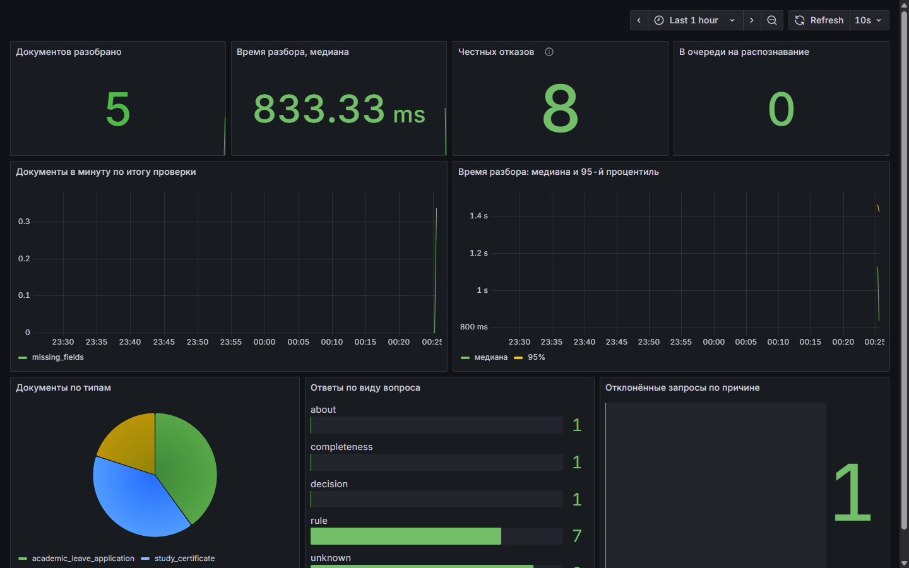

# Paragraf

A digital secretary for a university dean's office. A student uploads a photo of a certificate or an application and asks a question. The service reads the picture, fills in a card of fields, checks the required data and answers with a reference to the exact clause of the regulations.

Built for the "Online Dean's Office" case by Center-invest Bank. [Русская версия](README.md)


| Home page | Reading a document | Dark theme |
| --- | --- | --- |
|  |  |  |

| Batch checking | Type sandbox |
| --- | --- |
|  |  |

A short video walking through every scenario: [docs/pitch/demo.mp4](docs/pitch/demo.mp4), 2 minutes 4 seconds.

## Features

**Required level**

- Accepts a photo or a scan in JPG, PNG or PDF and a question in Russian.
- Recognizes text with Tesseract.
- Fills in the card for three document types. An empty field gets the value "не найдено" (not found).
- Checks completeness against the regulations and lists what is missing.
- Names the source in every answer: a clause of the regulations or a document field. "Почему так?" shows how the answer was reached: which kind of question was recognized, where the value came from, which words of the question are missing from the sources.
- Says so plainly when neither the document nor the regulations contain the answer.

**Advanced level**

- Detects the document type on its own.
- Handles poor pictures: tilt up to 30°, shadow, glare, low resolution, a sheet photographed on a desk.
- A new document type is one YAML file, with no code changes.
- Shows where each field was found on the picture.

**Beyond the brief**

- Reads certificates and applications written as running text, not only forms. Names are put into the nominative case.
- Does not reject documents of other types. For a protocol or an order it shows the title, the text and the label-value lines it found, and explains why such a document cannot be checked against the regulations.
- Reads PDF files up to 10 pages.
- Tells what the uploaded document is and answers questions about the regulations by quoting the right clause.

**For the dean's office**

- Remarks for the office: a period that ends before it starts, an issue date later than today, an internship certificate issued before the internship ended, a course outside 1–6, a programme code not in the 00.00.00 format. Remarks do not change the check against the regulations; they only point where to look.
- A rule-by-rule check: every clause shows the items it requires and which of them were found.
- An empty field is outlined on the picture where its value should have been.
- The card can be corrected by hand: the value is normalized, the check is redone at once and the field is marked as edited.
- A ready reply to the student listing what is missing with the clauses, copied in one click.
- "Скрыть данные" blacks out names, the document number and the signature on the picture and hides them in the card, answers, check sheet and JSON, so a result can be shared without personal data.
- A printable check sheet (or PDF) and a JSON export in the results.json format.
- Batch checking: up to 60 files at once, a result for each, a combined results.json and a CSV for Excel. Documents are grouped by student, and names that almost match (a masculine and a feminine surname, a full name and initials) are flagged as a possible typo.
- A type sandbox: describe a new document type in the browser and try it on a file right away; the service's own types stay untouched.

**For the student**

- Take a photo with the phone camera right from the page or paste a picture with Ctrl+V. Several photos of one document are read as its pages.
- If the photo is blurred, too small, shaded or tilted, the service says how to retake it.
- Compare the uploaded photo with the aligned sheet and see what was fixed before reading.
- Search the regulations with highlighted matches.
- The service installs on a phone like an app, and there is a Telegram bot with the same abilities.

## Quick start

Docker is the only requirement.

```sh
git clone https://github.com/dimon0804/PARAGRAF.git paragraf
cd paragraf
docker compose up --build
```

Open <http://localhost:8080>. The home page offers three sample documents, one per type.

A five-minute tour. It can also run on its own: Shift+D or the "Показать демо" link at the bottom of the page starts an autopilot that walks through the steps below on the live service with captions (Esc stops it). The same at <http://localhost:8080/?demo>.

1. On the home page pick the "Заявление на отпуск" sample and press "Разобрать документ". The service says the date is missing (clause 4.1) and outlines its place on the picture. Press the pencil next to "Дата заявления", type any date, and the check turns positive at once.
2. Ask "Какой размер стипендии положен студенту?" (the scholarship amount). Neither the document nor the regulations say it, and the service tells you so.
3. Ask in plain words: "На сколько можно уйти в академ?". The answer quotes clause 4.4.
4. Open "Пакетная проверка", load a few files from `data/open/documents` and download results.json.
5. At the bottom of the page open "Самопроверка на открытом наборе": the service reads the organizers' 30 documents in front of you, answers 120 questions and shows the metrics of `evaluate.py`.
6. Open "Новый тип", press "Взять пример протокола" and "Разобрать по описанию": a protocol, which is not one of the service's types, is read by the description in the editor.

## Running in Google Colab

No Docker at hand? Open the notebook: it installs the service on a free Colab machine, checks the open set and builds `results.json` for any set in the same format.

[](https://colab.research.google.com/github/dimon0804/PARAGRAF/blob/main/notebooks/paragraf_colab.ipynb)

## Producing results.json

```sh
docker compose build api
mkdir -p out
docker run --rm -v "$PWD/data/open:/data:ro" -v "$PWD/out:/out" paragraf-api \
  paragraf batch /data/documents.json --out /out/results.json

python data/open/evaluate.py \
  --reference data/open/reference_results.json \
  --predictions out/results.json
```

Point the command at the closed set folder to process it. Document types are taken from the manifest. The output follows `results.schema.json`, which a test verifies. A damaged file does not stop the run: it gets an empty card and a warning. Only the answer kinds defined by the format go into `results.json`; document summaries and quotes from the regulations work in the interface only.

## Quality

All numbers come from recognizing images. The PDF text layer is not used.

| Set | Documents | Fields | Check | Questions |
| --- | ---: | ---: | ---: | ---: |
| Open set from the organizers | 30 | 1.000 | 1.000 | 1.000 |
| Our own documents in the same layout | 90 | 1.000 | 1.000 | 1.000 |

Our own documents are produced by `tools/synth.py` with different names, universities, group codes and numbers. This shows that the service reads the document instead of remembering the open set.

Free-form documents come from `tools/freeform.py`: 42 certificates and applications written as running text, with no type hint.

| Set | Type detected | Fields |
| --- | ---: | ---: |
| Free-form documents | 42 of 42 | 0.990 |

Robustness was measured on the same 90 documents damaged by `tools/degrade.py`:

| What was done to the picture | Fields | Check | Questions |
| --- | ---: | ---: | ---: |
| Tilt up to 30° | 1.000 | 1.000 | 1.000 |
| Shadow over half of the sheet | 1.000 | 1.000 | 1.000 |
| Lamp glare | 1.000 | 1.000 | 1.000 |
| Low resolution, about 600 pixels wide | 1.000 | 1.000 | 1.000 |
| Heavy JPEG compression | 1.000 | 1.000 | 1.000 |
| Blur and noise | 1.000 | 1.000 | 1.000 |
| Sheet photographed on a desk: perspective, tilt, shadow, compression | 1.000 | 1.000 | 1.000 |

Speed was measured on the production stack with the container limited to two CPU cores and 2 GB of memory: 25 documents of the open set take 1.0 s each in the median and no more than 1.2 s, including alignment, recognition and the check. No GPU is needed. The result page shows each step with its time.

## How it works

1. **Intake.** The format is detected from the file content, not from its extension. PDF pages become images.
2. **Preparation.** The service finds the sheet on the desk and fixes perspective, estimates the tilt, evens out the light and enlarges small photos. When the sheet contour is doubtful, the picture is left uncropped.
3. **Recognition.** Tesseract 5 with the accurate Russian model returns words and their coordinates.
4. **Card.** Lines shaped like "Label: value" are matched to fields by fuzzy label comparison. Dates become `YYYY-MM-DD`; look-alike letters and digits in codes are repaired.
5. **Signature and seal.** Only the presence of a drawing is checked. The words "Подпись" and "М.П." do not count: recognized text is subtracted before the analysis.
6. **Check.** The card is compared with the required fields of the type.
7. **Answer.** A question is one of: completeness, a field value, who makes the final decision. Anything else is treated as unanswerable. No language model writes the answer, so the service cannot invent a fact.

## Adding a document type

Put a file into `config/doc_types`:

```yaml
id: library_card
title: Читательский билет
fields:
  - key: reader_name
    label: ФИО читателя
    type: person
    rule: "1.1"
  - key: card_number
    label: Номер билета
    type: code
    rule: "1.1"
```

After a restart the type appears in the interface, in type detection and in answers. The regulations live in `config/rules.md`.

A description can also be tried without restarting anything: the "Новый тип" page (`/sandbox`) takes it in an editor and applies it to the uploaded file for that one request. Since the description comes from a visitor, the sandbox turns off phrase patterns and choice maps (both are regular expressions), forbids YAML anchors and limits the size and the number of fields.

## Questions in the student's own words

The regulations say "the maximum length of the leave is not set", while a student asks "how long can I be away?". Short phrases from such questions are tied to clause numbers in `config/rules_hints.yaml`. The answer is always a verbatim quote of the clause.

We tried a small local language model for these questions (Vikhr-Qwen 1.5B through llama.cpp) and dropped it. It attached a real quote and then wrote something false on top of it, and it answered three of eighteen off-topic questions instead of refusing. The phrase hints reach the right clause on the same questions and never break a refusal.

## Handwriting

Tesseract reads printed text. For fields filled in by hand an open TrOCR model fine-tuned on Russian handwriting can be attached:

```sh
python tools/fetch_models.py handwriting
HANDWRITING_MODEL=/models/trocr-ru API_MEMORY=6g docker compose up --build
```

The model takes about 1.5 GB per worker process, so the service needs more memory than the default. In our run the container with the model used 4.2 GB.

In PowerShell set the variables first: `$env:HANDWRITING_MODEL="/models/trocr-ru"; $env:API_MEMORY="6g"; docker compose up --build`. In Git Bash put `MSYS_NO_PATHCONV=1` before the command, otherwise the shell rewrites `/models` into a Windows path.

Neither of the two versions we tested reads names reliably, so the model's reading is not treated as a fact. A value enters the card only when the printed OCR and the handwriting model independently read the same thing. Otherwise the field stays empty with a "filled in by hand" note and the model's reading is shown as a hint. On 30 documents filled in with handwriting fonts this cut wrong values in the card from 37 to 8. Reading accuracy did not improve.

### Mini App in Telegram

When the site is served over HTTPS, the bot can open it right inside Telegram: an "Открыть сервис" button in the /start reply and a menu button next to the input field. Pass the address with `BOT_TOKEN=... WEB_APP_URL=https://your-domain docker compose --profile bot up -d`. Only Telegram Web may embed the site in a frame.

## Questions by voice

There is a microphone button next to the question field. Speech is recognized by the small open Vosk model for Russian (about 45 MB) inside the service container; audio is never sent anywhere or stored. The browser converts the recording to 16 kHz WAV itself, so the service needs no extra tools. A recording is limited to 15 seconds and a phrase is recognized in under a second.

```sh
python tools/fetch_models.py speech
docker compose up -d
```

Without the model the microphone button simply does not appear.

## Monitoring

The API serves Prometheus metrics at `/metrics` on the internal network; the gateway does not expose it. Labels carry only the document type, the check result and the kind of question, never personal data. Prometheus and Grafana with a ready dashboard start under their own profile:

```sh
docker compose --profile monitoring up -d
```

The dashboard is at <http://localhost:3000>: documents read and their results, median and 95th percentile reading time, honest refusals, the OCR queue and rejected requests.



## Telegram bot

The case allows the interface to be a web page or a bot, and we have both. The bot uses the same pipeline as the site, but runs it inside its own process: the file is not sent anywhere else, not even to our API.

A student sends a photo or a JPG, PNG or PDF file up to 15 MB. If the file has a caption, it is treated as a question. The bot replies with the document type, the completeness check with links to the regulation points, the field card and the answer to the question. Later messages are treated as questions about the last document. Under the reply there are buttons with common questions and a button to pick the document type by hand when the bot got it wrong or did not recognise it.

To run the bot, create one with [@BotFather](https://t.me/BotFather) using `/newbot` and copy the token it gives you. Then:

```sh
BOT_TOKEN=123456:ABC... docker compose --profile bot up -d --build
```

In PowerShell: `$env:BOT_TOKEN="123456:ABC..."; docker compose --profile bot up -d --build`. Without the `bot` profile, `docker compose up` starts only the site, as before. If the token is missing, the bot exits right after start and the reason is shown in `docker compose logs bot`.

The bot needs internet access to `api.telegram.org`, so it runs on a separate network rather than on the API's internal one. It keeps the card of the last document in memory for 30 minutes to answer questions and writes nothing to disk. The file itself is not kept after processing; to re-read it as another type the bot downloads it from Telegram again.

Without Docker, run `paragraf bot` after `pip install -e ".[bot]"`; the token is read from `PARAGRAF_BOT_TOKEN`.

## Tools and models

No external OCR or language model APIs are used. Everything runs on the CPU of an ordinary laptop.

The word loader comes from the open [Uiverse.io](https://uiverse.io) collection (by kennyotsu, MIT) and was adapted to the service. Interface colors are built on the brand green of Center-invest Bank.

| Purpose | Tool |
| --- | --- |
| Text recognition | Tesseract 5.5, `rus` model from `tessdata_best` |
| Image processing | OpenCV, Pillow |
| PDF reading | PyMuPDF |
| Label matching | RapidFuzz |
| Word stems in questions | Snowball (Russian stemmer) |
| Name cases | pymorphy3 |
| Handwriting (optional) | TrOCR `trocr-base-handwritten-ru` in ONNX, ONNX Runtime |
| HTTP API | FastAPI, Uvicorn, Pydantic |
| Telegram bot (optional) | aiogram |
| Interface | React, TypeScript, Vite, Tailwind CSS, Base UI, Motion, Sonner, Lucide |
| Gateway | Caddy |
| Code checks | pytest, Ruff, Vitest, ESLint |

## Security and privacy

- A file is processed in memory and never stored. There is no database and there are no accounts.
- Only JPG, PNG and PDF up to 15 MB are accepted, with a limit on image size in pixels.
- Requests per address are rate limited.
- Containers run without root, with a read-only file system and no extra privileges. The API is not exposed; requests go through Caddy.
- A Content-Security-Policy and the other security headers are set. No third-party scripts, fonts or trackers are loaded.
- Logs hold the request time, the document type and the check result. Document contents are never logged.

## Development

```sh
cd backend
python -m venv .venv && . .venv/bin/activate
pip install -e ".[dev]"
pytest
uvicorn paragraf.api.app:app --reload

cd frontend
npm install
npm run dev
```

Local recognition needs Tesseract with the Russian language. Tests read the PDF text layer of the open set, so they pass without it.

The API description is served at `/api/docs`. Main endpoints:

- `POST /api/analyze` — a file (or several files as pages of one document) and an optional question; returns the card, the completeness check, photo tips (`analysis.advice`) and the aligned picture. An empty field whose label was found has a `hint_box` where the value should have been.
- `POST /api/ask` — a follow-up question about a card that was already read; no file needed.
- `POST /api/check` — a card corrected by hand: values are normalized and completeness is checked again.
- `GET /api/selfcheck` — a self-check on the open set: a stream of events (SSE) per document and the final `evaluate.py` metrics.
- `POST /api/sandbox` — a file and a type description in YAML; reads the file by that description without touching the service's types. `GET /api/sandbox/example` returns a sample description.

## Limitations

- Handwriting is not read reliably. Open models misread letters and the service must not invent, so a handwritten field stays empty unless its reading is confirmed.
- Phrase patterns for free-form documents cover common wordings, not all of them. They are extended in the config with no code changes.
- Up to 10 pages of a PDF are read. Pages are joined into one picture and fields are searched on all of them.
- The presence of a signature and a seal is checked, not their authenticity.
- The check is preliminary. The final decision belongs to a dean's office employee, clause 1.3 of the regulations.

## License

MIT. The data in `data/open` belongs to the hackathon organizers; all details in it are fictional.
