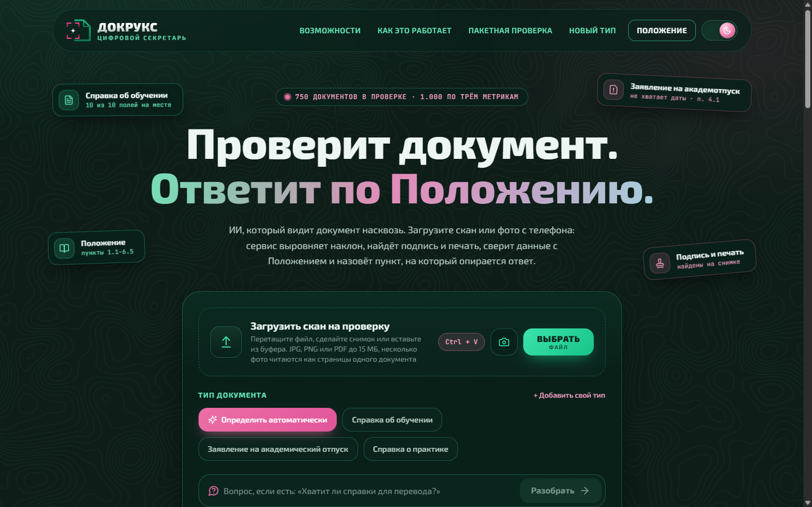

<div align="center">


# Докрукс

**ИИ, который видит документ насквозь.**

### [Открыть сервис: docrux.clv-digital.tech](https://docrux.clv-digital.tech)

[](https://docrux.clv-digital.tech)
[](https://t.me/docrux_bot)
[](docs/pitch/demo.mp4)

[](https://github.com/dimon0804/Docrux/actions/workflows/ci.yml)


</div>

Название сложено из document и crux («суть», «узел»): сервис добирается до сути документа и сверяет её с Положением без лишней бюрократии. Знак — рамка сканера вокруг искры рядом с листом документа: сервис наводится на документ и видит его насквозь.

Цифровой секретарь деканата. Студент загружает фото справки или заявления и задаёт вопрос. Сервис читает снимок, заполняет карточку полей, проверяет обязательные сведения и отвечает со ссылкой на пункт Положения.

Решение кейса «Онлайн-деканат» банка «Центр-инвест». [English version](README.en.md)



| Результат в светлой теме | Главная, светлая тема | Экран чтения документа |
| --- | --- | --- |
|  |  |  |

| Результат в тёмной теме | Пакетная проверка | Песочница типов |
| --- | --- | --- |
|  |  |  |

Короткое видео с проходом по всем сценариям: [docs/pitch/demo.mp4](docs/pitch/demo.mp4), 2 минуты 35 секунд.

## Что умеет

**Базовый уровень**

- Принимает фото или скан в JPG, PNG и PDF и вопрос на русском языке.
- Распознаёт текст с помощью Tesseract.
- Заполняет карточку полей для трёх типов документов. Пустое поле получает значение «не найдено».
- Проверяет комплектность по Положению и перечисляет, чего не хватает.
- В каждом ответе называет источник: пункт Положения или поле документа. По кнопке «Почему так?» видно, как получен ответ: какой вид вопроса распознан, откуда взято значение, каких слов вопроса нет в источниках.
- Если ответа нет ни в документе, ни в Положении, прямо говорит об этом и советует обратиться в деканат.

**Продвинутый уровень**

- Сам определяет тип документа.
- Справляется с плохими снимками: наклон до 30°, тень, блик, низкое разрешение, фото листа на столе.
- Новый тип документа добавляется одним YAML-файлом, код менять не нужно.
- Показывает на снимке, откуда взято каждое поле.

**Сверх задания**

- Читает справки и заявления, написанные сплошным текстом, а не только бланки. ФИО приводит к именительному падежу: «Петровой Анне Сергеевне» становится «Петрова Анна Сергеевна».
- Не отвергает документы других типов. Для протокола или приказа показывает название, текст и найденные строки «Метка: значение» и объясняет, почему проверить их по Положению нельзя.
- Читает PDF до 10 страниц.
- Рассказывает, что за документ загружен, и отвечает на вопросы по самому Положению цитатой нужного пункта.

**Для сотрудника деканата**

- Сверка с Положением: по каждому пункту видно, какие сведения он требует и какие из них нашлись.
- Замечания для сотрудника: окончание периода раньше начала, дата выдачи позже сегодняшнего дня, справка о практике выдана до её окончания, курс вне 1–6, шифр направления не в формате 00.00.00. На итог проверки по Положению замечания не влияют, они только подсказывают, куда посмотреть.
- Пустое поле отмечено пунктиром на снимке там, где должно было стоять значение.
- Карточку можно поправить вручную: значение приводится к формату, проверка повторяется сразу, поле помечается как исправленное.
- Готовый ответ студенту с перечнем недостающего и пунктами Положения, копируется в один клик.
- Кнопка «Скрыть данные» закрашивает ФИО, номер документа и подпись на снимке и прячет их в карточке, ответах, листе проверки и JSON. Так результат можно переслать или показать, не раскрывая персональные данные.
- Лист проверки для печати или PDF и выгрузка результата в JSON в формате results.json.
- Пакетная проверка: до 60 файлов за раз, итог по каждому, общий results.json и таблица для Excel. Документы группируются по студентам, а почти совпадающие ФИО («Захаров» и «Захарова», полное имя и инициалы) отмечаются как возможная опечатка.
- Песочница типов: новый тип документа описывается в браузере и сразу пробуется на файле, настоящие типы сервиса при этом не меняются.

**Для студента**

- Снимок можно сделать камерой телефона прямо со страницы или вставить из буфера сочетанием Ctrl+V. Несколько фото одного документа читаются как его страницы.
- Если фото смазано, мелкое, с тенью или сильно наклонено, сервис подскажет, как переснять.
- Можно сравнить загруженное фото с выровненным листом и увидеть, что было исправлено перед чтением.
- Поиск по Положению с подсветкой найденных слов.
- Сервис устанавливается на телефон как приложение. Есть Telegram-бот с теми же возможностями.

## Быстрый запуск

Нужен только Docker.

```sh
git clone https://github.com/dimon0804/Docrux.git docrux
cd docrux
docker compose up --build
```

Ещё проще: на Windows дважды щёлкните `start.cmd`, на Linux и macOS выполните `sh start.sh`. Скрипт проверит, что Docker запущен, соберёт и поднимет сервис, дождётся готовности и откроет браузер.

Откройте <http://localhost:8080>. Внизу карточки загрузки есть три готовых примера, по одному на каждый тип документа: «Без замечаний», «Без даты» и «Без печати».

Что посмотреть за пять минут. Можно и без рук: Shift+D или ссылка «Показать демо» внизу страницы запускает автопилот, который сам проходит сценарии ниже на настоящем сервисе с подписями (Esc останавливает). То же самое по адресу <http://localhost:8080/?demo>.

1. На главной нажмите пример «Без даты» (заявление на отпуск) и розовую кнопку «Разобрать». Сервис скажет, что не хватает даты (п. 4.1), и отметит пунктиром место на снимке. Нажмите карандаш у поля «Дата заявления», впишите любую дату, и проверка сразу станет положительной.
2. Спросите «Какой размер стипендии положен студенту?». Ответа нет ни в документе, ни в Положении, и сервис так и скажет.
3. Спросите своими словами: «На сколько можно уйти в академ?». Ответ придёт цитатой пункта 4.4.
4. Откройте «Пакетная проверка», загрузите несколько файлов из `data/open/documents` и скачайте results.json.
5. Внизу страницы нажмите «Самопроверка на открытом наборе»: сервис при вас прочитает 30 документов организаторов, ответит на 120 вопросов и покажет метрики скрипта `evaluate.py`.
6. Откройте «Новый тип», нажмите «Взять пример протокола» и «Разобрать по описанию»: протокол, которого нет среди типов сервиса, прочитан по описанию из редактора.

Если пакеты Debian скачиваются медленно, укажите зеркало:

```sh
APT_MIRROR=mirror.yandex.ru docker compose up --build
```

## Запуск в Google Colab

Если Docker под рукой нет, откройте ноутбук: он ставит сервис на бесплатной машине Colab, проверяет открытый набор и собирает `results.json` для любого набора в том же формате.

[](https://colab.research.google.com/github/dimon0804/Docrux/blob/main/notebooks/docrux_colab.ipynb)

## Свой сервер и домен

Так запущен наш сервис на <https://docrux.clv-digital.tech>. Домен должен указывать на сервер, порты 80 и 443 открыты. Перед сайтом встаёт внешний Caddy, который сам получает сертификат Let's Encrypt:

```sh
DOMAIN=docrux.example.ru HTTP_PORT=127.0.0.1:8080   docker compose -f docker-compose.yml -f deploy/docker-compose.domain.yml up -d --build
```

Бот и мониторинг добавляются профилями `--profile bot --profile monitoring`. Чтобы бот открывал сайт кнопкой внутри Telegram, передайте ещё `WEB_APP_URL=https://ваш-домен`.

## Как получить results.json

Команда обрабатывает все документы набора и отвечает на все вопросы из `questions.json`:

```sh
docker compose build api
mkdir -p out
docker run --rm -v "$PWD/data/open:/data:ro" -v "$PWD/out:/out" docrux-api \
  docrux batch /data/documents.json --out /out/results.json
```

Если команда сообщает, что не может записать файл, дайте папке права на запись: `chmod 777 out`. Контейнер работает от обычного пользователя, а не от root.

Проверка скриптом организаторов:

```sh
python data/open/evaluate.py \
  --reference data/open/reference_results.json \
  --predictions out/results.json
```

Для закрытого набора достаточно подставить его папку вместо `data/open`. Типы документов берутся из манифеста. Результат соответствует схеме `results.schema.json`: это проверяется тестом. Если какой-то файл набора окажется повреждён, прогон не остановится: для него запишется пустая карточка, а в консоли появится предупреждение.

В `results.json` попадают только те виды ответов, которые описаны в формате: проверка комплектности, значение поля, кто принимает решение и отказ. Рассказ о документе и цитаты из Положения работают только в интерфейсе.

Один документ можно разобрать прямо из консоли:

```sh
docker run --rm -v "$PWD/data/open:/data" docrux-api \
  docrux read /data/documents/open-002.png -q "Какова дата выдачи?"
```

## Как проверить каждое требование

Каждое утверждение этого README можно проверить командой. Команды выполняются из корня репозитория.

| Требование | Чем подтверждено | Команда |
| --- | --- | --- |
| results.json проходит `evaluate.py` организаторов, 1.000 по трём метрикам | job «OCR accuracy on the open set» в CI, страница самопроверки | раздел «Как получить results.json» выше или <http://localhost:8080/selfcheck> |
| Формат results.json соответствует `results.schema.json` | тест `test_results_follow_the_organizers_schema` | `cd backend && pytest tests/test_open_set.py` |
| Сервис читает документ, а не узнаёт его по имени файла или id | те же 30 документов под случайными именами, с другими id, без типа в манифесте и в обратном порядке дают те же карточки, проверки и ответы | `cd backend && pytest tests/test_open_set.py -k file_names` |
| Тип документа определяется сам | тот же тест: в переименованном манифесте типов нет, все 30 определены верно | `cd backend && pytest tests/test_open_set.py -k file_names` |
| Подпись и печать определяются по рисунку, а не по словам «Подпись» и «М.П.» | на открытом наборе 50 отметок из 50 (41 есть, 9 нет), ложных срабатываний нет | метрика полей в `evaluate.py` |
| PNG и PDF одного документа дают одинаковый результат | прогон по PDF тоже даёт 1.000 | команда из «Как получить results.json» с `--source pdf` |
| Ответы не зависят от формулировки и ничего не выдумывают | вопросы открытого набора, переписанные другими словами, и вопросы, ответа на которые нет | `cd backend && pytest tests/test_paraphrase.py tests/test_scope.py` |
| Ответ ссылается на поле или пункт Положения | тест `test_answer_text_agrees_with_structured_value` | `cd backend && pytest tests/test_open_set.py` |
| Плохие снимки | таблица в разделе «Качество», наборы собираются скриптом `tools/degrade.py` | `python tools/degrade.py --help` (нужны пакеты из `backend`: `pip install -e backend`) |
| Весь стек поднимается одной командой, API закрыт снаружи, контейнеры без root | job «Full stack through docker compose» в CI | `docker compose up -d --build --wait` |

Полная сверка с презентацией кейса по пунктам: [docs/requirements.md](docs/requirements.md).

## Качество

Все цифры получены распознаванием изображений. Текстовый слой PDF не используется.

| Набор | Документов | Поля | Проверка | Вопросы |
| --- | ---: | ---: | ---: | ---: |
| Открытый набор организаторов | 30 | 1.000 | 1.000 | 1.000 |
| Свои документы в том же оформлении | 90 | 1.000 | 1.000 | 1.000 |

Свои документы собирает `tools/synth.py`. В них другие фамилии, вузы, шифры групп и номера, в том числе с буквами «ё», «щ», «ъ» и двойными фамилиями. Так мы убедились, что сервис читает документ, а не помнит открытый набор.

Документы свободной формы собирает `tools/freeform.py`: 42 справки и заявления сплошным текстом, тип сервису не подсказывается.

| Набор | Тип определён | Поля |
| --- | ---: | ---: |
| Документы свободной формы | 42 из 42 | 0.990 |

Устойчивость к плохим снимкам измерена на тех же 90 документах, испорченных скриптом `tools/degrade.py`:

| Что сделано со снимком | Поля | Проверка | Вопросы |
| --- | ---: | ---: | ---: |
| Наклон до 30° | 1.000 | 1.000 | 1.000 |
| Тень на половину листа | 1.000 | 1.000 | 1.000 |
| Блик от лампы | 1.000 | 1.000 | 1.000 |
| Низкое разрешение, ширина около 600 пикселей | 1.000 | 1.000 | 1.000 |
| Сильное сжатие JPEG | 1.000 | 1.000 | 1.000 |
| Смаз и шум | 1.000 | 1.000 | 1.000 |
| Фото листа на столе: перспектива, наклон, тень, сжатие | 1.000 | 1.000 | 1.000 |

Скорость измерена на боевом стеке, контейнер ограничен двумя ядрами процессора и 2 ГБ памяти: 25 документов открытого набора разбираются за 1,0 секунды в медиане и не дольше 1,2 секунды каждый, вместе с выравниванием снимка, распознаванием и проверкой. Видеокарта не нужна. Ход разбора с временем каждого шага показан на странице результата.

## Как это устроено

```
файл ──► проверка формата ──► подготовка снимка ──► OCR ──► карточка полей ──► проверка ──► ответ
          сигнатура, размер    лист, наклон, свет   Tesseract  метки из YAML    Положение    источник
```

1. **Приём файла.** Формат определяется по содержимому файла, а не по расширению. Страницы PDF превращаются в изображения.
2. **Подготовка снимка.** Сервис находит лист на фоне стола и исправляет перспективу, определяет угол наклона, выравнивает освещение и увеличивает мелкие фото. Если контур листа вызывает сомнение, снимок не обрезается.
3. **Распознавание.** Tesseract 5 с точной моделью русского языка возвращает слова и их координаты.
4. **Карточка.** Строки вида «Метка: значение» сопоставляются с полями по нечёткому сравнению меток. Даты приводятся к `ГГГГ-ММ-ДД`, в номерах и шифрах исправляются похожие буквы и цифры. Если документ написан сплошным текстом, поля ищутся по образцам фраз из описания типа. В бланке пустое поле с меткой остаётся пустым: сервис не подставляет в него значение из другого места.
5. **Подпись и печать.** Проверяется наличие рисунка. Слова «Подпись» и «М.П.» отметкой не считаются: область распознанного текста вычитается перед анализом.
6. **Проверка.** Карточка сверяется с обязательными полями типа. Для полного документа указываются все пункты с требованиями, для неполного только нарушенные.
7. **Ответ.** Вопрос относится к одному из видов: комплектность, значение поля, кто принимает решение. В интерфейсе к ним добавляются рассказ о документе и поиск пункта Положения. Поиск по Положению лексический: слова приводятся к основам, редкие слова весят больше. Если в вопросе есть значимое слово, которого нет нигде в Положении, например «стипендия» или «телефон», сервис отвечает, что информации нет. Ответы этих видов собирает код, языковая модель в них не участвует.

## Новый тип документа

Добавьте файл в `config/doc_types`. Например, читательский билет:

```yaml
id: library_card
title: Читательский билет
detect:
  titles: ["читательский билет"]
fields:
  - key: reader_name
    label: ФИО читателя
    type: person
    rule: "1.1"
  - key: card_number
    label: Номер билета
    type: code
    rule: "1.1"
    ask: ["какой номер у билета"]
  - key: signature_present
    label: Подпись библиотекаря
    type: mark
    mark: signature
    rule: "1.1"
```

После перезапуска тип появится в интерфейсе, в автоопределении и в ответах на вопросы. Для документов свободной формы в том же файле задаются образцы фраз в разделе `freeform`: регулярные выражения с группой `value` и готовыми кусками `{fio}`, `{date}`, `{name}`, `{code}`. Примеры есть в описаниях трёх встроенных типов. Типы значений: `text`, `person`, `date`, `integer`, `code`, `mark`. В `aliases` перечисляются другие написания метки на документе, в `ask` примеры вопросов студента.

Положение лежит в `config/rules.md`. Сервис разбирает его на нумерованные пункты при старте.

Описание типа можно попробовать, ничего не перезапуская: на странице «Новый тип» (`/sandbox`) оно вставляется в редактор и сразу применяется к загруженному файлу. Описание действует только на этот разбор. Поскольку его присылает посетитель, в песочнице отключены образцы фраз и словари приведения (это регулярные выражения), запрещены YAML-якоря, а размер описания и число полей ограничены.

## Вопросы своими словами

В Положении написано «максимальная длительность отпуска не установлена», а студент спросит «на сколько можно уйти в академ?». Чтобы такие вопросы находили свой пункт, в `config/rules_hints.yaml` к номерам пунктов привязаны короткие фразы из живых вопросов. Ответом всегда остаётся дословная цитата пункта.

Мы пробовали отдать такие вопросы небольшой локальной языковой модели (Vikhr-Qwen 1.5B через llama.cpp) и отказались от неё. Модель приводила настоящую цитату, но писала поверх неё неправду: на вопрос «Вы оформите мне отпуск?» отвечала «Да», хотя по пункту 1.3 сервис ничего не оформляет. На трёх вопросах из восемнадцати не по теме она ответила вместо отказа. Подсказки в конфиге дают верный пункт на тех же вопросах и не ошибаются в отказах.

## Рукописный текст

Tesseract читает печатный текст. Для полей, заполненных от руки, можно подключить открытую модель TrOCR, дообученную на русском почерке:

```sh
python tools/fetch_models.py handwriting
HANDWRITING_MODEL=/models/trocr-ru API_MEMORY=6g docker compose up --build
```

Модель занимает около 1,5 ГБ на каждый рабочий процесс, поэтому сервису нужно больше памяти, чем по умолчанию. В нашем запуске контейнер с моделью занимал 4,2 ГБ.

В PowerShell переменные задаются отдельно: `$env:HANDWRITING_MODEL="/models/trocr-ru"; $env:API_MEMORY="6g"; docker compose up --build`. В Git Bash перед командой нужен `MSYS_NO_PATHCONV=1`, иначе оболочка превратит `/models` в путь Windows.

Мы проверили две версии модели. Ни одна не читает ФИО надёжно, а в датах модель ошибается уверенно. Поэтому её чтение не считается фактом. Значение попадает в карточку, только если печатное распознавание и рукописная модель независимо прочитали одно и то же. Иначе поле остаётся пустым с пометкой «заполнено от руки», а чтение модели показывается как подсказка для самопроверки.

На 30 документах, заполненных рукописными шрифтами, это сократило число неверных значений в карточке с 37 до 8. Точность чтения при этом не выросла: модель помогает не выдумывать, но не помогает прочитать. На печатных документах проверка ничего не меняет.

### Мини-приложение в Telegram

Если сайт доступен по HTTPS, бот может открывать его прямо внутри Telegram: кнопка «Открыть сервис» в ответе на /start и кнопка меню рядом с полем ввода. Адрес передаётся так: `BOT_TOKEN=... WEB_APP_URL=https://ваш-домен docker compose --profile bot up -d`. Встраивать сайт во фрейм разрешено только Telegram Web.

## Вопросы голосом

Рядом с полем вопроса есть кнопка микрофона. Речь распознаёт маленькая открытая модель Vosk для русского языка (около 45 МБ) прямо в контейнере сервиса, звук никуда не отправляется и не сохраняется. Браузер сам приводит запись к WAV 16 кГц, поэтому сервису не нужны дополнительные программы. Запись ограничена 15 секундами, фраза распознаётся меньше чем за секунду.

```sh
python tools/fetch_models.py speech
docker compose up -d
```

Если модели нет, кнопка микрофона не появляется, остальное работает как обычно.

## Мониторинг

API отдаёт метрики Prometheus по адресу `/metrics` во внутренней сети: шлюз наружу его не открывает. В метках только тип документа, итог проверки и вид вопроса, персональных данных там нет. Prometheus и Grafana с готовой панелью запускаются отдельным профилем:

```sh
docker compose --profile monitoring up -d
```

Панель откроется на <http://localhost:3000>: сколько документов разобрано и с каким итогом, медиана и 95-й процентиль времени разбора, честные отказы, очередь распознавания, отклонённые запросы.


## Telegram-бот

Кейс разрешает сделать интерфейс страницей или ботом, у нас есть и то и другое. Бот работает на том же разборе, что и сайт, только внутри своего процесса: файл никуда не пересылается, даже в наш API.

Студент присылает фото или файл JPG, PNG или PDF до 15 МБ. Если у файла есть подпись, она считается вопросом. В ответ бот пишет тип документа, итог проверки по Положению со ссылками на пункты, карточку полей и ответ на вопрос. Следующие сообщения тоже считаются вопросами к последнему документу. Под ответом есть кнопки с частыми вопросами и кнопка, чтобы выбрать тип документа вручную, если бот определил его неверно или не узнал.

Чтобы запустить бота, создайте его у [@BotFather](https://t.me/BotFather) командой `/newbot` и скопируйте выданный токен. Потом:

```sh
BOT_TOKEN=123456:ABC... docker compose --profile bot up -d --build
```

В PowerShell: `$env:BOT_TOKEN="123456:ABC..."; docker compose --profile bot up -d --build`. Без профиля `bot` команда `docker compose up` запускает только сайт, как раньше. Если токен не передан, бот завершается сразу после запуска, а причина видна в `docker compose logs bot`.

Боту нужен выход в интернет к `api.telegram.org`, поэтому он работает в отдельной сети, а не во внутренней сети API. Карточку последнего документа бот помнит в памяти 30 минут, чтобы отвечать на вопросы, и ничего не записывает на диск. Сам файл после разбора не хранится, для повторного разбора с другим типом бот заново скачивает его из Telegram.

Наш бот: [@docrux_bot](https://t.me/docrux_bot).

Если сервер не достаёт до Telegram напрямую, укажите прокси в переменной `BOT_PROXY` (в файле `.env` рядом с `docker-compose.yml` или в окружении): `socks5://логин:пароль@адрес:порт` или `http://...`. Если Telegram или прокси на время недоступны, бот не завершается, а пробует снова с растущей паузой до двух минут. Неверный токен останавливает его сразу.

Без Docker бот запускается командой `docrux bot` после `pip install -e ".[bot]"`, токен берётся из переменной `DOCRUX_BOT_TOKEN`.

## Инструменты и модели

Внешние API распознавания и языковых моделей не используются. Все вычисления идут на процессоре обычного ноутбука, видеокарта не нужна.

| Назначение | Инструмент |
| --- | --- |
| Распознавание текста | Tesseract 5.5, модель `rus` из набора `tessdata_best` |
| Обработка изображений | OpenCV, Pillow |
| Чтение PDF | PyMuPDF |
| Сравнение меток | RapidFuzz |
| Основы слов в вопросах | Snowball (русский стеммер) |
| Падежи в ФИО | pymorphy3 |
| Рукописный текст (по желанию) | TrOCR `trocr-base-handwritten-ru` в формате ONNX, ONNX Runtime |
| HTTP API | FastAPI, Uvicorn, Pydantic |
| Telegram-бот (по желанию) | aiogram |
| Интерфейс | React, TypeScript, Vite, Tailwind CSS, Base UI, Motion, Sonner, Lucide, шрифты Exo 2 и JetBrains Mono |
| Шлюз | Caddy |
| Проверка кода | pytest, Ruff, Vitest, ESLint |

Одна страница обрабатывается примерно за секунду.

Загрузчик со сменой слов взят из открытой коллекции [Uiverse.io](https://uiverse.io) (автор kennyotsu, лицензия MIT) и подогнан под оформление сервиса. Оформление по макету дизайнеров команды: тёмно-зелёная и светлая мятная темы, мятный и розовый акценты, топографический фон.

## Безопасность и приватность

- Файл обрабатывается в памяти и не сохраняется. Базы данных и учётных записей нет.
- Карточка возвращается в браузер. Для следующих вопросов браузер присылает её обратно, сам файл повторно не передаётся.
- Принимаются только JPG, PNG и PDF до 15 МБ. Есть ограничение на размер изображения в пикселях.
- Число запросов с одного адреса ограничено.
- Контейнеры работают без прав администратора, с файловой системой только для чтения и без лишних привилегий. API недоступен снаружи, запросы идут через Caddy.
- Заданы Content-Security-Policy и остальные заголовки безопасности. Сторонние скрипты, шрифты и счётчики не подключаются.
- В журнал попадают время запроса, тип документа и итог проверки. Содержимое документов не записывается.

## Разработка

```sh
# сервер
cd backend
python -m venv .venv && . .venv/bin/activate
pip install -e ".[dev]"
pytest
uvicorn docrux.api.app:app --reload

# интерфейс
cd frontend
npm install
npm run dev
```

Для распознавания на своей машине нужен Tesseract с русским языком. Тесты читают текстовый слой PDF из открытого набора, поэтому проходят и без него.

Описание API доступно по адресу `/api/docs`. Основные методы:

- `POST /api/analyze` — файл (или несколько файлов как страницы одного документа) и необязательный вопрос; в ответе карточка, проверка комплектности, советы по съёмке (`analysis.advice`) и выровненный снимок. У пустого поля с найденной меткой есть `hint_box`: место, где должно было стоять значение.
- `POST /api/ask` — следующий вопрос по уже разобранной карточке, файл не нужен.
- `POST /api/check` — карточка после ручной правки: значения приводятся к виду карточки, комплектность проверяется заново.
- `GET /api/selfcheck` — самопроверка на открытом наборе: поток событий (SSE) по документам и итоговые метрики `evaluate.py`.
- `POST /api/sandbox` — файл и описание типа в YAML; разбор по этому описанию без изменения типов сервиса. Пример описания отдаёт `GET /api/sandbox/example`.

## Структура

```
backend/          сервер: распознавание, карточка, проверка, ответы, API
config/           типы документов и Положение
frontend/         интерфейс студента
data/open/        открытый набор организаторов и скрипт проверки
tools/            генераторы документов, порча снимков для замеров, закачка моделей
models/           необязательные модели (в репозиторий не входят)
docs/pitch/       текст презентации и сценарий демо
notebooks/        ноутбук для Google Colab
docs/case/        презентация кейса
```

## Частые проблемы

| Что случилось | Что сделать |
| --- | --- |
| `start.cmd` пишет, что Docker не запущен | Запустите Docker Desktop, дождитесь статуса Engine running и запустите `start.cmd` ещё раз |
| Порт 8080 занят | Задайте другой: `HTTP_PORT=8090 docker compose up --build` (в PowerShell `$env:HTTP_PORT="8090"`), сайт откроется на этом порту |
| Сборка долго качает пакеты Debian | Укажите зеркало: `APT_MIRROR=mirror.yandex.ru docker compose up --build` |
| `docker run ... docrux batch` не может записать файл | Дайте папке права на запись: `chmod 777 out`, контейнер работает не от root |
| Страница открылась, но разбор не идёт | Подождите, пока контейнер `api` станет `healthy` (`docker compose ps`), первый запуск занимает до минуты |
| Нет кнопки микрофона | Модель голоса не скачана: `python tools/fetch_models.py speech`, затем `docker compose up -d` |
| Бот не отвечает | Посмотрите `docker compose logs bot`. Если там `bot_network_retry`, сервер не достаёт до Telegram, укажите прокси в `BOT_PROXY` |

## Ограничения

- Рукописный текст надёжно не читается. Открытые модели ошибаются в буквах, а сервису запрещено выдумывать, поэтому поле, заполненное от руки, остаётся пустым, если чтение не удалось подтвердить. Подробности в разделе о дополнительных моделях.
- Образцы фраз для документов свободной формы покрывают распространённые формулировки, но не все. Справку с необычным построением текста сервис может прочитать не полностью. Образцы дополняются в конфиге без правок кода.
- В PDF читается до 10 страниц. Страницы склеиваются в один снимок, поля ищутся на всех.
- Проверяется наличие подписи и печати, но не их подлинность.
- Сервис делает предварительную проверку. Окончательное решение принимает сотрудник деканата, пункт 1.3 Положения.

## Лицензия

MIT. Данные в `data/open` принадлежат организаторам хакатона, все сведения в них вымышлены.
